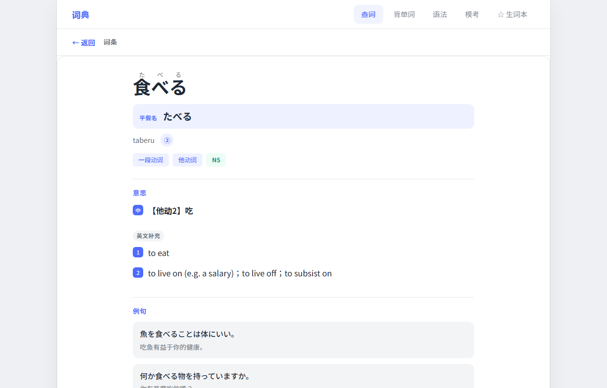
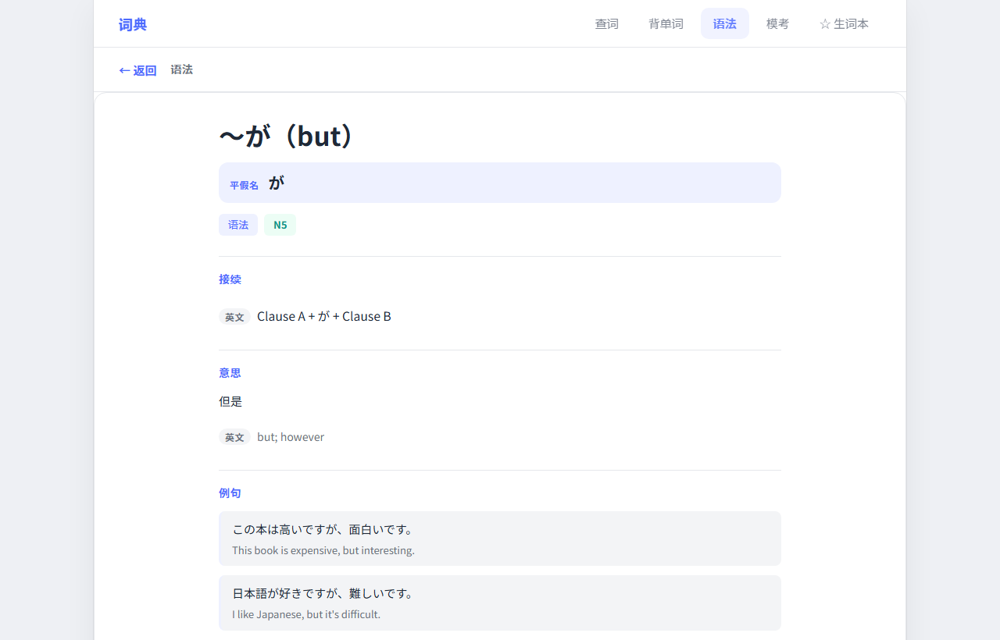

# 日语学习

[](https://github.com/rrrryf/japanese-learning/actions/workflows/tests.yml)
[](LICENSE)
[](https://www.python.org/)
[]()

本地推理优先的日语学习应用：**词典 + 语法 + JLPT 模考 + 薄弱点复盘**，可选接入 Ollama 本地小模型做按需讲解。

> 个人 JLPT 备考工具 / 作品集项目。默认不依赖任何云端 API。

| 查词 | 语法 |
|---|---|
|  |  |
| 振假名 / 罗马音 / 音调 / 中文释义 / 活用表 / 双语例句 | 接续 + 中文释义 + 双语例句，英文单独标注 |

| 模考列表 | 答题 |
|---|---|
|  |  |
| 五个等级各一套示例卷，支持导入自己的题库 | 专项训练、进度条、交卷后进薄弱点复盘 |

## 为什么做这个

备考 JLPT 时现成工具要么在线、要么订阅制，离线就没有。这个项目把数据全部落到本机：
JMdict 建成本地 SQLite，中文释义和例句用开放语料补齐，AI 讲解跑在本机 Ollama 上。
断网也能查词、练题、复盘。

## 技术要点

**离线优先的数据层** — 21.9 万词条的 JMdict 解析进 SQLite（`entries` / `senses` / `word_forms` 三表），
`word_forms(seq)` 索引是性能命脉：缺了它 `/api/jlpt` 从 47ms 掉到 16 秒。

**搜索性能优化** — 中文释义反查要扫 2.4 万行 `gloss_zh`，是最大瓶颈。
加了「查询含假名且已有结果就跳过反查」的判断后，`食べる` 从 208ms 降到 **14ms**；
JLPT 列表去掉逐条回表的 N+1，100 条从 195ms 降到 **27ms**；
例句查询改用 FTS5 trigram 索引（三字以上走 `MATCH`，更短的词形与旧库退回 `instr`），
词条详情从 15ms 降到 **1.7ms**。

**用本地模型补数据** — 上游中文词典只覆盖 5.4% 的词条，JLPT 五级本来只有 75–90%。
写了脚本用本机 7B 模型批量翻译缺口词的英文释义，跑三轮把 JLPT 覆盖补到 **98%+**，
产出单独存成 `gloss_zh_extra.jsonl.gz`，与上游数据分开、可回滚。

**安全加固** — 本地服务也要防：Host 白名单挡 DNS rebinding（含 IPv6 方括号解析）、
POST 端点强制 `application/json` 挡跨站简单请求、所有整数参数夹在 int64 内
（超出会让 SQLite 抛 `OverflowError`，那不是 `sqlite3.Error`，会冒成 500）、
第三方题库 HTML 走白名单重建（`<template>` 懒解析 + 元素过滤）。

**测试与 CI** — 30 项纯函数单元测试（活用生成、数据校验、日志读写、答案分布）+ 
72 项接口回归（输入边界、注入、CSRF、并发、导入、降级），GitHub Actions 自动跑单元测试。

## 三步跑起来（Windows）

```powershell
# 1. 准备数据（首次运行，会自动下载词库，约 30MB）
python setup_data.py

# 2. 装依赖并启动（首次会自动建虚拟环境）
.\start.ps1

# 3. 浏览器打开
#    http://127.0.0.1:8765/
```

`run.bat` 与 `start.ps1` 等价，双击即可。

### 关于第 1 步

`setup_data.py` 做四件事：

| 步骤 | 说明 |
|---|---|
| 下载词库 | 从 EDRDG 拉 `JMdict_e.gz`（约 30MB）并解压成 `JMdict_e.xml` |
| 建 SQLite | 调用 `build_db.py` 生成 `jmdict.db`（词条 / 义项 / 词形，约 80MB） |
| 导入语法 | openjlpt 100 条 + thesaurus 830 条 → `grammar` 表（共 930 条，五级均有） |
| 校验 | 打印各表行数，确认接口可用 |

脚本幂等，可重复运行。如果网络受限，也可以手动下载 `JMdict_e.xml` 放到项目根目录后再跑一次。

**没有 `jmdict.db` 时**：服务仍能启动，页面顶部会出现一条黄色提示条，查词与语法返回「词典库未就绪」——不会白屏。

### 可选：本地讲解模型

> **这一步可以跳过。** 不装 Ollama 也能正常查词、看语法、做模考；只是词条页的「本地讲解」按钮会提示本机未响应。Ollama 与模型（`qwen2.5:7b` 约 4.7 GB）只影响讲解功能。

```powershell
# 先安装 Ollama（https://ollama.com），然后
ollama pull qwen2.5:7b
```

模型可换：`$env:OLLAMA_MODEL='qwen2.5:7b'` 后再启动。

> **关于模型**：默认 `qwen2.5:7b`，讲解质量可用，但 7B 单次讲解约 6–10 秒。
> 想更快可换更小的模型（例如 `qwen2.5:3b`），代价是讲解质量下降。
> 换模型只需设置 `$env:OLLAMA_MODEL='模型名'`，前端显示会自动跟随。
> 任何本地小模型的讲解都可能出错——实测 7B 级仍会偶发混淆自他动词、夹带英文单词。
> **请当作辅助参考**，词形、读音、释义以词典区和例句为准。

---

## 功能

| 模块 | 说明 | 数据来源 |
|---|---|---|
| 词典 | 日文/假名/中文反查、活用表、罗马音 | JMdict（本地 SQLite） |
| 语法 | **930 条句型**，接续 / 中文释义 / 英文释义 / 部分带双语例句 | `data/openjlpt_grammar_*.json` + `data/grammar_extra.jsonl.gz` |
| 模考 | 词汇 / 文法 / 读解专项，交卷后进「薄弱点复盘」 | 仓库内 `web/data/mock_exams/`（示例卷） |
| 本地题库导入 | 真题页上传 `.json` 卷子（可多选 / 拖拽），存在本机、可删除 | 本地文件 |
| 薄弱点 | 按科目统计正确率，反哺每日计划 | 本地练习日志 |
| 本地讲解（**可选**） | 词条/语法详情页「本地讲解」按钮 → Ollama。**不装不影响上面任何功能** | 本机 Ollama |

### 关于示例卷

`web/data/mock_exams/` 提供 **N5–N1 各一套示例卷**（每套 4–13 题），用于演示刷题与复盘流程。按同样 JSON 格式可自行增补：

```
web/data/mock_exams/
  lists.json                 # 各等级卷子清单
  mock-n2-practice.json      # 一套卷子的题目
```

### 导入自己的题库

真题页上方有「**＋ 导入题库**」按钮，可以：

- 点按钮选择 `.json` 卷子（支持多选）
- 或直接把文件**拖到真题页**
- 或把文件放进 `web/cache/imported_exams/`，刷新页面就出现

导入的卷子保存在 `web/cache/imported_exams/`，**已被 `.gitignore` 排除**，不会进版本库；列表里带「本地」标记，右侧 `×` 可删除。

单套卷子的最小格式：

```json
{
  "title": "我的 N3 卷",
  "tag": "N3",
  "questions": [
    {
      "id": "q1",
      "subject": "vocabulary",
      "sectionTitle": "词汇 · 读音",
      "title": "次の言葉の読み方を選びなさい。<u>約束</u>",
      "options": ["やくそく", "やくぞく", "やっそく", "やくそこ"],
      "answer": 0,
      "analysis": "「約束」读作「やくそく」。"
    }
  ]
}
```

`tag` 必须是 N5–N4–N3–N2–N1 之一；每题 `options` 至少 2 个、`answer` 是正确选项下标（从 0 开始）。不合格的题会被跳过，整套没有可用题时导入失败并说明原因。

> 导入的是付费题库内容时请自行留意：这个功能只负责把它存在你本机，**不要提交到仓库或分享出去**。

### 数据构成

| 表 | 内容 | 来源 |
|---|---|---|
| `entries` / `senses` / `word_forms` | 218,945 词条 / 253,841 义项 / 499,554 词形 | JMdict（本机下载生成，约 80 MB） |
| `grammar` | **930 条语法**（N5 159 / N4 114 / N3 122 / N2 80 / N1 43，其余未分级） | `openjlpt_grammar_*.json` 100 条 + `grammar_extra.jsonl.gz` 830 条 |
| `jlpt` | 8,138 条分级词表 | `data/jlpt_words.jsonl.gz`（37 KB） |
| `gloss_zh` | 23,101 条中文释义 + 音调 | `data/gloss_zh.jsonl.gz`（346 KB，上游 thesaurus） |
| 　└ 补充 | +1,421 条（填 JLPT 词表缺口） | `data/gloss_zh_extra.jsonl.gz`（14 KB，本机模型翻译） |
| `examples` | 32,424 条双语例句 | `data/examples.jsonl.gz`（970 KB） |

四份 gzip JSONL 随仓库分发（合计约 1.4 MB），`setup_data.py` 会自动导入；完整词库仍在你本机生成。

### 中文释义覆盖情况

上游 thesaurus 只覆盖 11,924 个词条（全库 5.4%），JLPT 五个等级本来只有 75–90%。所以用本机 Ollama 把**JLPT 词表缺的 1,421 个词**补上了：

| 等级 | 补前 | 补后 |
|---|---|---|
| N5 | 87.4% | **98.8%** |
| N4 | 89.4% | **99.8%** |
| N3 | 89.6% | **98.7%** |
| N2 | 80.6% | **98.4%** |
| N1 | 75.3% | **98.9%** |

补充数据单独放在 `gloss_zh_extra.jsonl.gz`，与上游数据分开，重跑 `setup_data.py` 不会丢。生僻词、专有名词、古语仍只有英文释义——查不到中文时详情页会说明原因。

重新生成补充数据：

```powershell
python scripts/fill_gloss_zh.py --db jmdict.db            # 全量补缺口
python scripts/fill_gloss_zh.py --db jmdict.db --dry-run --limit 10   # 先看 10 条
```

> 这些译文由 7B 级本地模型生成，个别词义可能不准（例如把「書き取り」译成"写作"而非"听写"）。介意的话可以在 `gloss_zh_extra.jsonl.gz` 里手改，或用更大的模型重跑。

### 语法例句的可靠性

930 条语法里 **409 条有例句**（N5 79% / N4 72% / N3 72% / N2 81% / N1 91%），来源分两类：

| 来源 | 条数 | 可靠性 | 界面标记 |
|---|---|---|---|
| openjlpt（人工编写） | 100 | 可作教材用 | 无标记 |
| 本机 7B 模型生成 | 309 | **约 50–75% 准确** | 橙色「AI 生成」标签 |

模型生成的例句常见问题：

- **没用上语法点**（要求用 `〜次第で`，给出「時間帯によって営業時間が異なります」）
- **接续错误**（`たりとも` 接在动词辞书形后面）
- **句子不完整**（短语片段当成句子）

所以看到「AI 生成」标签时请自行核对。剩余 521 条空例句的多数是带占位符的复杂 pattern（`~のは~です`、`~のではないでしょうか`），这类模型理解不了接续结构，实测 `batch=1` 也仅 50% 成功率，**不值得硬补**——错的例句比没有更糟。

要补的话两个方向：换更大的模型（14B 以上），或手工补 N1/N2 那几十条。

导出脚本在 `scripts/export_data.py`：如果你有自己的完整词库，可以重跑它刷新这些数据文件。

---

## 环境变量

| 变量 | 默认 | 说明 |
|---|---|---|
| `JMDICT_DB` | 项目根 `jmdict.db` | 自定义词库路径 |
| `JMDICT_GZ_URL` | EDRDG 官方地址 | `setup_data.py` 的下载源 |
| `SKIP_DOWNLOAD` | 未设置 | 设为 `1` 时跳过下载（已有 XML 时用） |
| `OLLAMA_BASE` | `http://127.0.0.1:11434` | Ollama 地址 |
| `OLLAMA_MODEL` | `qwen2.5:7b` | 模型名 |
| `OLLAMA_TIMEOUT` | `120` | 讲解超时（秒） |

---

## 目录结构

```
japanese-learning/
  README.md
  setup_data.py             # 一键数据准备（下载 + 建库 + 导入语法）
  build_db.py               # JMdict XML → SQLite
  start.ps1 / run.bat       # 启动（含端口占用检测）
  jmdict.db                 # setup_data.py 生成（不入库）
  data/                     # 语法 JSON + 分级/释义/例句（gzip JSONL，约 1.4MB）
  scripts/eval_explain.py   # 讲解评测脚本
  docs/screenshots/         # 界面截图
  docs/HANDOFF.md           # 架构与开发交接说明
  web/
    main.py                 # FastAPI 路由
    lookup.py               # 查词 / 语法 / 例句查询
    mock_exam.py            # 本地模考
    weakness.py             # 薄弱点分析
    ai_ollama.py            # 本地讲解
    db.py                   # 只读连接
    data/mock_exams/        # 示例卷 JSON
    static/                 # 前端（原生 JS，无构建）
    cache/                  # 运行期缓存
```

---

## 常见问题

**端口 8765 被占用**
`start.ps1` 会自动检测并改用 8766 起，提示里会给出实际地址。也可以手动指定：
```powershell
cd web
.\.venv\Scripts\uvicorn.exe main:app --port 9000
```

**页面显示「词典库未就绪」**
没找到 `jmdict.db`。跑 `python setup_data.py`，或把已有的 `jmdict.db` 放到项目根目录，然后重启。

**「本地讲解」按钮点了报错**
Ollama 没启动，或没有对应模型。先 `ollama serve`，再 `ollama pull qwen2.5:7b`。页面会提示「本机 Ollama 未响应」。

**装依赖很慢**
首次 `start.ps1` 会装 fastapi + uvicorn 等 19 个包。可以换国内镜像：
```powershell
.\.venv\Scripts\pip.exe install -r requirements.txt -i https://pypi.tuna.tsinghua.edu.cn/simple
```

---

## 数据来源与协议

本项目不自造词典内容，全部来自下列公开数据源。**再分发时请保留署名。**

| 数据 | 上游 | 许可 |
|---|---|---|
| 词条 / 义项 / 词形 | [JMdict](https://www.edrdg.org/wiki/index.php/JMdict-EDICT_Dictionary_Project)（EDRDG） | **CC-BY-SA 4.0** |
| 中文释义 / 音调 | [Japanese-Chinese-thesaurus](https://github.com/lxl66566/Japanese-Chinese-thesaurus)（lxl66566） | **The Unlicense**（公有领域） |
| 双语例句 | [Tatoeba](https://tatoeba.org/)（CC-BY 2.0 FR） | **CC-BY 2.0 FR** |
| JLPT 分级词表 | 依据 JLPT 官方出题基准整理 | 事实性数据，无版权限制 |
| 语法条目 `openjlpt_grammar_*.json`（100 条） | 本项目整理 | 随本项目 |
| 语法条目 `grammar_extra.jsonl.gz`（830 条） | [Japanese-Chinese-thesaurus](https://github.com/lxl66566/Japanese-Chinese-thesaurus) | **The Unlicense**（公有领域） |
| 模考题目（`web/data/mock_exams/`） | 本项目自建示例 | 随本项目 |

### 两点要注意

**① 代码与数据的许可不同。**
代码（`web/`、`scripts/`）可按作品集用途自由使用；但 `jmdict.db` 及其衍生数据包含 JMdict 内容，适用 **CC-BY-SA 4.0**——分发时要署名 EDRDG，且**修改后的词典数据库需以相同协议共享**。

**② 例句署名。**
`data/examples.jsonl.gz` 来自 Tatoeba，CC-BY 2.0 FR 要求署名。导出脚本（`scripts/export_data.py`）已剔除正文含个人邮箱的条目，避免把他人联系方式带进分发物。

> 如果你要把这些数据用于商业产品，请先分别确认上表的许可条款；其中只有 Japanese-Chinese-thesaurus（Unlicense）与 JLPT 词表没有额外限制。

## License

- **代码**：MIT（见 [LICENSE](LICENSE)）
- **数据**：各自遵循上表所列上游协议（JMdict 部分为 CC-BY-SA 4.0）

## 更新记录

每个版本做了什么、修了什么问题、性能变化多少，都记在 [CHANGELOG.md](CHANGELOG.md)。
当前版本 **v1.1.0**（语法 930 条 / 例句 409 条 / 中文覆盖率 98%）。

